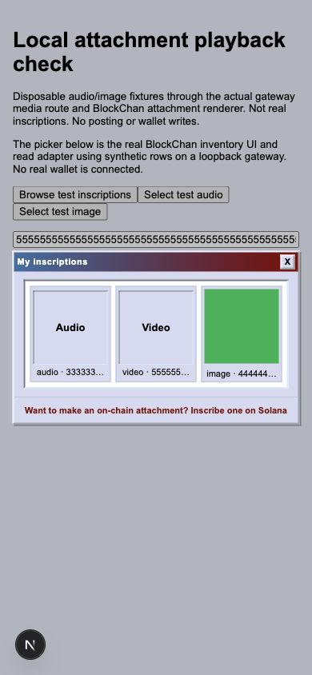
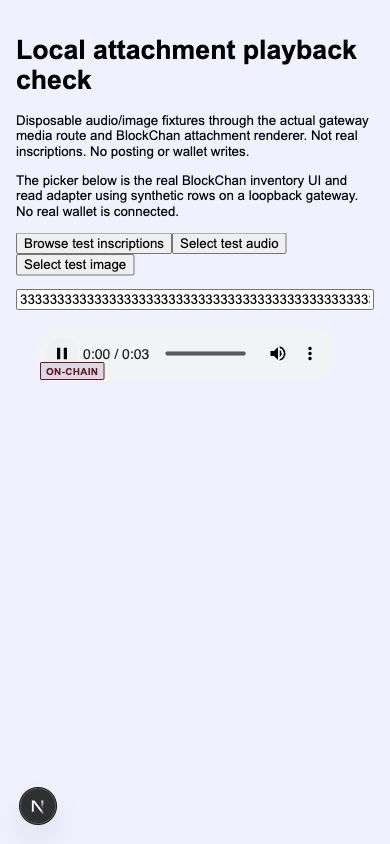
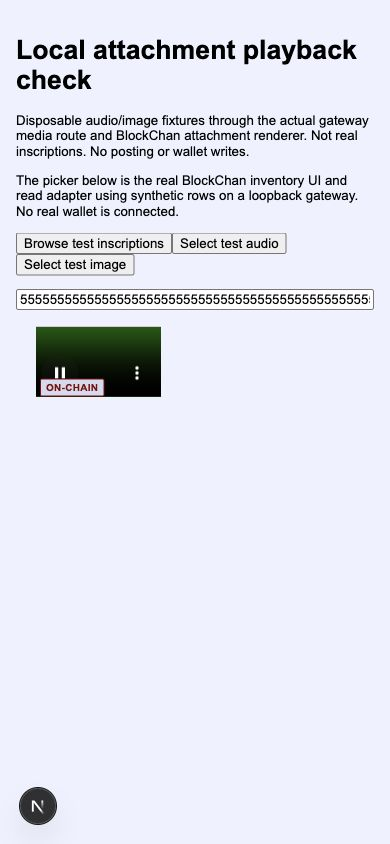

# Local media verification

The screenshots show synthetic local inventory rows through the actual BlockChan
picker and gateway media route. They are not a deployed/mainnet acceptance claim.
No private wallet, key, RPC credential or QA server is included.

See `evidence.json` for scope, checks and deployment order. Gateway viewer styling
remains identical to upstream. Audio/video tiles read only existing inventory row
metadata; payloads load after selection through the shared attachment renderer.
