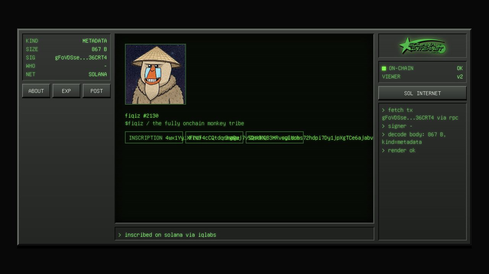
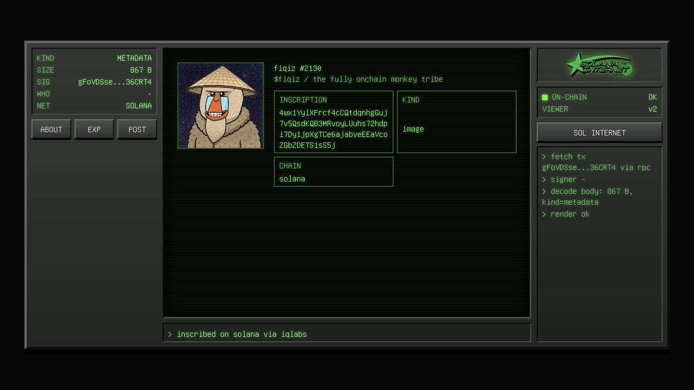
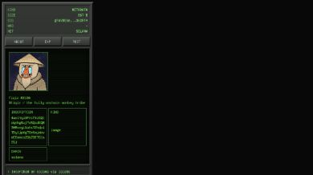

# NFT viewer and share-image regression

Reproduced with public mainnet Fiqiz #2130 metadata and its 88-character image inscription signature. No wallet connections, signatures or transactions were made.

Before: long metadata attributes overflowed their boxes; `/render` produced a PNG containing the image record's JSON/base64 text. Favicon tags pointed to 404s on the deployed host.

After: metadata attributes wrap within Zo's existing console; image records and known NFT image-inscription pointers reuse the existing cached decoder and produce bounded PNG previews. Explicit favicon routes use bundled artwork with module-relative paths. The preview revision changes so stale generated cards are not reused. Previously shared links may still need a chat application's cache refresh after deployment.

Actual local PNG output from the public inscription:

Validation: 162 Bun tests passed. The isolated regression covers cached WebP records, metadata pointers, actual PNG decoding, stale-cache bypass, ETags, no arbitrary network image fetch, and favicon requests from another working directory. Desktop/390px layout measurements showed no attribute or page overflow. No private source art/layers/keys are included.

`sharp` is added for WebP-to-PNG conversion: the existing resvg decoder did not paint WebP inputs. Conversion uses a 16-million-pixel limit, a 1200px maximum output, a five-second processing timeout and the existing render cache. It performs no chain scans. Text previews retain resvg and its SVG fallback; original `/img` formats stay unchanged. Both package locks include the dependency. Linux deployment remains subject to CI/operator rollout; this PR does not deploy itself.
